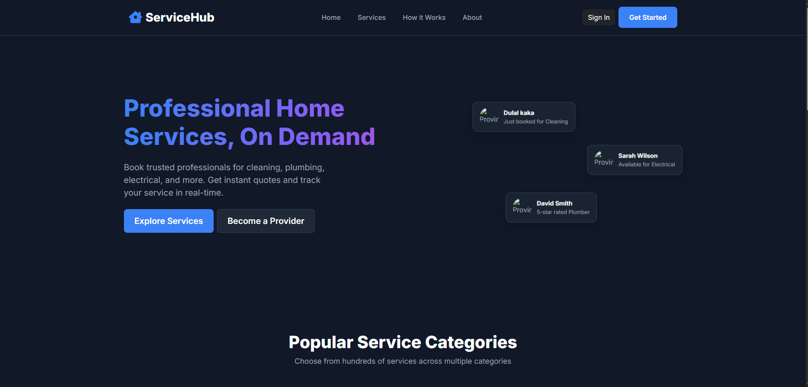
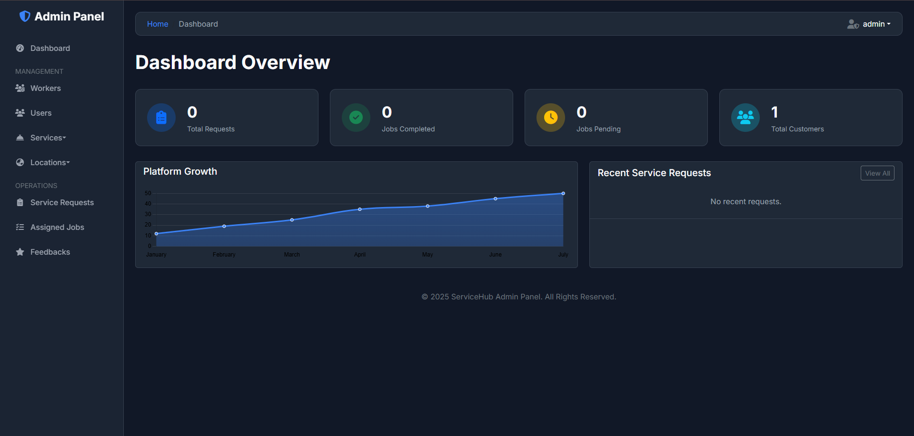
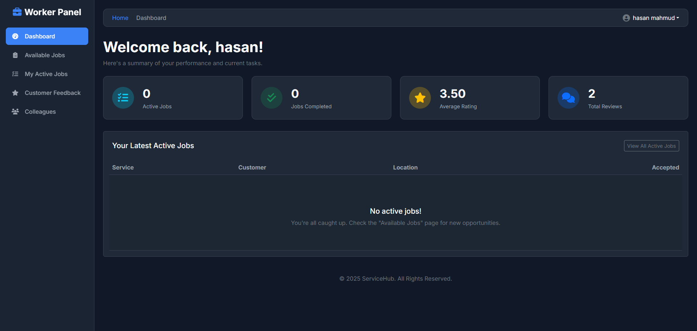

<div align="center">

<br/>

```
 ███████╗███████╗██████╗ ██╗   ██╗██╗ ██████╗███████╗██╗  ██╗██╗   ██╗██████╗ 
 ██╔════╝██╔════╝██╔══██╗██║   ██║██║██╔════╝██╔════╝██║  ██║██║   ██║██╔══██╗
 ███████╗█████╗  ██████╔╝██║   ██║██║██║     █████╗  ███████║██║   ██║██████╔╝
 ╚════██║██╔══╝  ██╔══██╗╚██╗ ██╔╝██║██║     ██╔══╝  ██╔══██║██║   ██║██╔══██╗
 ███████║███████╗██║  ██║ ╚████╔╝ ██║╚██████╗███████╗██║  ██║╚██████╔╝██████╔╝
 ╚══════╝╚══════╝╚═╝  ╚═╝  ╚═══╝  ╚═╝ ╚═════╝╚══════╝╚═╝  ╚═╝ ╚═════╝ ╚═════╝ 
```

### 🔧 Next-Gen On-Demand Home Services & Technician Management Platform

<br/>

[](https://python.org)
[](https://djangoproject.com)
[](https://postgresql.org)
[](https://getbootstrap.com)
[](https://www.chartjs.org/)
[](https://leafletjs.com/)

<br/>

[](https://opensource.org/licenses/MIT)
[](http://makeapullrequest.com)
[](https://github.com/Tanbir-Hasan-247)
[](https://github.com/Tanbir-Hasan-247)

<br/>

[**Live Demo**](https://github.com/Tanbir-Hasan-247) · [**Report a Bug**](https://github.com/Tanbir-Hasan-247/ServiceHub/issues) · [**Request a Feature**](https://github.com/Tanbir-Hasan-247/ServiceHub/issues)

<br/>

</div>

---

## 📖 Table of Contents

- [About The Project](#-about-the-project)
- [Screenshots](#-screenshots)
- [Top Real-World Features](#-top-real-world-features)
- [Role-Based Feature Matrix](#-role-based-feature-matrix)
- [Tech Stack](#-tech-stack)
- [Architecture & Workflow](#-architecture--workflow)
- [Getting Started](#-getting-started)
  - [Prerequisites](#prerequisites)
  - [Installation](#installation)
  - [Database Setup & Migrations](#database-setup--migrations)
  - [Automated Verification Test Suite](#automated-verification-test-suite)
- [Environment Variables](#-environment-variables)
- [Project Structure](#-project-structure)
- [Roadmap](#-roadmap)
- [Contributing](#-contributing)
- [License](#-license)
- [Contact](#-contact)

---

## 🌟 About The Project

**ServiceHub** is an enterprise-grade, full-stack on-demand home service marketplace web application built with **Django** and **PostgreSQL/SQLite**. It connects customers seeking household repairs, maintenance, and cleaning services with verified, skilled technicians — all supervised in real time by an administrative operations panel.

From **interactive map pin-drops** and **live GPS technician tracking (Uber/Pathao style)** to **multi-gateway payment processing (bKash, Nagad, Cards)**, **worker wallet payout requests**, **bilingual language toggling (EN/বাংলা)**, and **automated PDF invoices**, ServiceHub delivers an end-to-end, production-ready SaaS experience.

> 💡 **Why ServiceHub?**  
> Finding trustworthy home technicians with upfront pricing is painful. ServiceHub eliminates guesswork with transparent hourly rates, customizable service packages/add-ons, live ETA tracking, instant in-app messaging, verified reviews, and automated 90/10 revenue sharing.

---

## 📸 Screenshots

<div align="center">

| 🏠 Customer Home & Services | 🛡️ Admin Analytics & Revenue | 👷 Technician Workspace & Wallet |
|:---:|:---:|:---:|
|  |  |  |

</div>

---

## 🔥 Top Real-World Features

### 1. 🛵 Live GPS Technician Tracking & Interactive Maps
- **Interactive Map Pin-Drop:** During booking, customers drop a pin on an interactive Leaflet/Google Maps view to pinpoint their exact location with latitude and longitude.
- **Live Moving Location:** When a worker switches their job status to **"On the Way"**, the technician's live coordinates stream to the server every 3–5 seconds using the browser `navigator.geolocation.watchPosition` API.
- **Real-Time Customer Map Modal:** Customers view the technician's vehicle/bike moving toward their home on an interactive live map with real-time **Haversine distance (km)** and **live ETA (minutes)** calculations.
- **One-Click Google Maps Directions:** Technicians have a 1-click **"Open in Google Maps"** button that opens turn-by-turn navigation directly to the customer's doorstep.

### 2. 💳 Smart Billing, Commission Split & Multi-Gateway Checkout
- **Automated Bill Calculation:** Calculated as:
  $$\text{Total Bill} = (\text{Hourly Rate} \times \text{Hours Worked}) + \sum \text{Selected Add-on Packages}$$
- **Automated 90/10 Revenue Split:** 90% is allocated directly to the worker's payout balance and 10% is recorded as platform commission.
- **Multi-Method Checkout:** Customers can pay online using **bKash**, **Nagad**, **Rocket**, **Credit/Debit Card**, or select **Cash on Service**.
- **Unique Transaction ID:** Each paid booking receives a unique TrxID (`TXN-...`) with instant receipt generation.

### 3. 💰 Worker Virtual Wallet & Payout Withdrawal System
- **Virtual Earnings Wallet:** Technicians track their accrued earnings, lifetime withdrawals, and pending payouts in a dedicated wallet (`/worker/wallet/`).
- **Withdrawal Requests:** Workers submit payout requests specifying their withdrawal method (**bKash**, **Nagad**, or **Bank Account**) and account details.
- **Admin Review Panel:** Administrators review, approve, or reject withdrawal requests at `/manage_withdrawals/`, which instantly deducts the worker's wallet balance upon approval.

### 4. 📄 Downloadable PDF Invoices & Money Receipts
- **Professional PDF Generation:** Customers and technicians can download official PDF receipts generated via `ReportLab` (`/appointment/invoice/<id>/pdf/`).
- **Detailed Invoice Breakdown:** Features auto-generated invoice numbers, service date, technician info, hourly rate breakdown, add-ons itemization, VAT/tax, and digital stamp verification.
- **Printable Modal Receipts:** 1-click browser-printable payment receipts with clean transaction metadata.

### 5. 📦 Service Packages & Extra Add-On Collection
- **Modular Add-Ons:** Customers can select optional equipment and deep-service materials (e.g., *Gas Refill (+৳1200)*, *Jet Wash (+৳400)*, *Anti-Bacterial Sanitize (+৳500)*).
- **Live Bill Estimator:** The booking form dynamically computes estimated total costs as add-ons are toggled on and off.
- **Pre-populated Add-on Catalog:** Comes pre-seeded with 26 service packages across categories like AC repair, plumbing, house cleaning, electrical, painting, and carpentry.

### 6. 💬 In-App Direct Customer-Worker Messaging & Quick Call
- **In-App Job Chat:** Active bookings feature a dedicated, private chat room (`/chat/<response_id>/`) for clear communication regarding service requirements and location directions.
- **One-Click Dialing:** Instant `Call Worker` and `Call Customer` buttons (`tel:`) enable quick phone calls with zero friction.

### 7. 📈 Visual Executive Analytics Dashboard (Chart.js)
- **Monthly Platform Revenue Curve:** Visualizes Gross Merchandise Value (GMV) alongside platform commission over time.
- **City Demand Distribution:** Interactive doughnut chart displaying booking demand by metropolitan area.
- **Top Earning Technicians Leaderboard:** Ranks top service professionals by total earnings and completed jobs with custom rank badges (#1 Gold, #2 Silver, #3 Bronze).
- **Interactive KPI Cards:** Real-time metrics for total revenue, active jobs, pending payments, and customer reviews with filtered query links.

### 8. 🌐 Bilingual Support (English & Bengali [EN | বাংলা])
- **Instant Client-Side Toggle:** A persistent `[EN | বাংলা]` toggle pill in the navbar instantly switches navigation, headings, status badges, and booking forms without reloading the page.
- **Saved User Preference:** Language selection persists across sessions using browser `localStorage`.

### 9. 🔔 Real-Time Notification Bell System
- **Dynamic Notification Center:** Bell dropdown with live unread badge counters.
- **Automated Lifecycle Alerts:** Notifies users on worker assignment, arrival status, job completion, payment receipts, and payout approvals.
- **Mark As Read Controls:** Individual and "Mark all read" actions.

### 10. 👤 Modern SaaS UI & Dynamic Profile Picture Integration
- **Dynamic Profile Avatars:** If the user has an uploaded photo, a circular avatar image is rendered in navbars and dropdowns; otherwise, an icon fallback (`<i class="fa fa-user"></i>`) renders cleanly.
- **Glassmorphic Design:** Sticky headers, custom dark-mode scrollbars, card hover elevations, and status timeline progress bars.

---

## 👥 Role-Based Feature Matrix

| Feature | 👤 Customer | 👷 Technician | 👑 Administrator |
|---|:---:|:---:|:---:|
| **Account Registration & Role Separation** | ✅ | ✅ (Needs Verification) | ✅ (Superuser) |
| **Browse Services & Search Filters** | ✅ | ✅ | ✅ |
| **Interactive Map Pin-Drop Booking** | ✅ | — | — |
| **Service Add-On Packages Selection** | ✅ | — | ✅ (Manageable) |
| **Live Order Timeline (6-Stage Stepper)** | ✅ | ✅ | ✅ |
| **Live GPS Technician Tracking (Map & ETA)**| ✅ | ✅ (Auto-Stream GPS) | — |
| **In-App Real-Time Messaging & Direct Call** | ✅ | ✅ | ✅ (Audit Access) |
| **Online Payments (bKash/Nagad/Card)** | ✅ | — | — |
| **Virtual Wallet & Payout Withdrawals** | — | ✅ | ✅ (Approve/Reject) |
| **Official PDF Invoice & Print Receipts** | ✅ | ✅ | ✅ |
| **Star Rating & Written Reviews** | ✅ | ✅ (View Ratings) | ✅ (Moderation) |
| **Worker Availability Status Toggle** | — | ✅ | ✅ |
| **Multi-City Service Area Coverage** | — | ✅ (Multi-Select) | ✅ (Full CRUD) |
| **Visual Analytics & Chart.js Dashboards** | — | ✅ (Rating Trend) | ✅ (Revenue Curve & Pie) |
| **Language Toggle (English / বাংলা)** | ✅ | ✅ | ✅ |

---

## 🛠️ Tech Stack

<div align="center">

| Component | Technology | Description |
|:---|:---|:---|
| **Backend Framework** | **Django 6.0+ / Python 3.12+** | Robust, scalable web framework using Class-Based Views (CBVs) |
| **Database** | **PostgreSQL 14+ / SQLite** | Relational storage with optimized foreign-key relationships |
| **Frontend Styling** | **Bootstrap 5.3 + Custom CSS** | Responsive dark glassmorphism design system |
| **Icons & Fonts** | **Font Awesome 6 & Inter** | Modern typography and vector iconography |
| **Visual Analytics** | **Chart.js 4.4+** | Responsive, interactive line, bar, and doughnut charts |
| **Mapping & Location**| **Leaflet 1.9+ & Geolocation API** | GPS pinpointing, live tracking markers, and Haversine ETA |
| **PDF Generation** | **ReportLab 4.0+** | Server-side pixel-perfect commercial invoice generation |
| **Data Tables** | **jQuery DataTables** | Searchable, paginated operational data views |
| **Configuration** | **python-decouple** | Secure environment variable handling via `.env` |
| **Image Engine** | **Pillow 10.0+** | Dynamic avatar and service thumbnail processing |

</div>

---

## 🏗️ Architecture & Workflow

```
                               ┌────────────────────────────────────────┐
                               │               ServiceHub               │
                               │        Django Class-Based Views        │
                               └───────────────────┬────────────────────┘
                                                   │
         ┌─────────────────────────────────────────┼────────────────────────────────────────┐
         │                                         │                                        │
         ▼                                         ▼                                        ▼
┌──────────────────┐                     ┌──────────────────┐                     ┌──────────────────┐
│  Customer Portal │                     │  Worker Portal   │                     │   Admin Portal   │
├──────────────────┤                     ├──────────────────┤                     ├──────────────────┤
│ • Map Pin-Drop   │                     │ • GPS Location   │                     │ • Verification   │
│ • Service Add-ons│ ─── Booking Req ──► │   Streaming      │ ◄── Job Assign ──── │ • Job Allocation │
│ • Multi-Pay Gate │                     │ • Virtual Wallet │                     │ • Payout Approval│
│ • Live ETA Track │ ◄── Live Track ──── │ • In-App Chat    │                     │ • Visual Charts  │
│ • PDF Invoices   │                     │ • Status Update  │                     │ • Full Audit Logs│
└──────────────────┘                     └──────────────────┘                     └──────────────────┘
         │                                         │                                        │
         └─────────────────────────────────────────┼────────────────────────────────────────┘
                                                   │
                                                   ▼
                               ┌────────────────────────────────────────┐
                               │           Django ORM Engine            │
                               │  ServiceRequests • Response • Wallet   │
                               └───────────────────┬────────────────────┘
                                                   │
                                                   ▼
                               ┌────────────────────────────────────────┐
                               │    PostgreSQL / SQLite Database        │
                               └────────────────────────────────────────┘
```

---

## 🚀 Getting Started

### Prerequisites

Ensure the following runtimes are installed on your system:
- **Python** `>= 3.12` — [Download](https://python.org/downloads)
- **Git** — [Download](https://git-scm.com/)
- **PostgreSQL** `>= 14` *(Optional, SQLite works out of the box for development)*

---

### Installation

**1. Clone the repository**
```bash
git clone https://github.com/Tanbir-Hasan-247/ServiceHub.git
cd "Home-Service-Web-Application/Home Service Django Project"
```

**2. Create and activate a virtual environment**
```bash
# Windows
python -m venv home_env
.\home_env\Scripts\activate

# macOS / Linux
python3 -m venv home_env
source home_env/bin/activate
```

**3. Install dependencies**
```bash
pip install -r requirements.txt
```

---

### Database Setup & Migrations

**1. Run migrations**
```bash
python manage.py migrate
```

**2. Seed service packages & add-on catalog (Optional)**
```bash
# Populates 26 add-on accessories (AC cleaning, gas refill, pipe leak kits, etc.)
python test_all_features.py
```

**3. Create an administrator account**
```bash
python manage.py createsuperuser
```

**4. Start the development server**
```bash
python manage.py runserver
```

Open **[http://127.0.0.1:8000/](http://127.0.0.1:8000/)** in your browser.

---

### Automated Verification Test Suite

ServiceHub includes an automated test script (`test_all_features.py`) to verify all core functional modules:

```bash
python test_all_features.py
```

**Test Coverage:**
- ✅ **Test 1:** Service Add-Ons seeding & category matching.
- ✅ **Test 2:** Hourly billing, add-on total, and 90/10 revenue split formula.
- ✅ **Test 3:** Worker live GPS location endpoint & Haversine distance ETA calculation.
- ✅ **Test 4:** Admin Analytics charts serialization & technician leaderboard aggregation.
- ✅ **Test 5:** Bilingual translation dictionary assets & template integrity.

---

## 🔐 Environment Variables

Create a `.env` file in the project root alongside `manage.py`:

```env
# ─── Django Security ──────────────────────────────────────────
SECRET_KEY=your_secret_key_here
DEBUG=True

# ─── Database Configuration (PostgreSQL) ─────────────────────
# Leave empty or omit if running SQLite
DB_NAME=servicehub_db
DB_USER=postgres
DB_PASSWORD=your_password
DB_HOST=localhost
DB_PORT=5432

# ─── Email Configuration (Gmail SMTP) ─────────────────────────
EMAIL_USER=your_email@gmail.com
EMAIL_PASS=your_16_digit_app_password
```

---

## 📁 Project Structure

```
Home Service Django Project/
│
├── manage.py                          # Django CLI utility
├── requirements.txt                   # Production dependencies
├── test_all_features.py               # Comprehensive automated QA test suite
├── .env                               # Environment configurations (Git-ignored)
│
├── HomeServices_project/              # Project Configuration
│   ├── settings.py                    # Global settings, context processors, auth backends
│   ├── urls.py                        # Root URL routing
│   ├── wsgi.py                        # WSGI server gateway
│   └── asgi.py                        # ASGI server gateway
│
├── HomeServices_app/                  # Core Business Application
│   ├── models.py                      # Models (users, workers, ServiceRequests, Response, Wallet, etc.)
│   ├── views.py                       # Modular Class-Based Views (CBVs) & handlers
│   ├── urls.py                        # Application URL mapping
│   ├── context_processors.py          # Global notification counter & dynamic profile avatar helper
│   │
│   ├── static/                        # Static Assets
│   │   ├── css/                       # Custom styles
│   │   └── js/
│   │       └── bilingual.js           # Client-side English & Bengali translation engine
│   │
│   └── templates/                     # UI Templates
│       ├── userpages/                 # Customer views (index, booking, history, checkout, invoice)
│       ├── workerpages/               # Technician views (dashboard, jobs, wallet, profile)
│       ├── adminpages/                # Admin views (analytics, workers, withdrawals, services)
│       └── chat/                      # Customer-Worker live messaging room
│
└── media/                             # Uploaded media (profile pictures, service icons)
```

---

## 🗺️ Roadmap

- [x] ✅ **Three-Role User Hierarchy** (Customer, Technician, Super Admin)
- [x] ✅ **Service Add-On Packages & Modular Item Selection**
- [x] ✅ **Interactive Map Pin-Drop Location Selection** (Leaflet / Google tiles)
- [x] ✅ **Live GPS Technician Tracking** (3–5s coordinate polling & Haversine ETA)
- [x] ✅ **Class-Based View (CBV) Architectural Refactor**
- [x] ✅ **Multi-Gateway Payment System** (bKash, Nagad, Rocket, Cards, Cash)
- [x] ✅ **Worker Virtual Wallet & Admin Payout Withdrawal Engine**
- [x] ✅ **Downloadable Commercial PDF Invoices & Money Receipts** (`ReportLab`)
- [x] ✅ **In-App Direct Customer-Worker Messaging & 1-Click Dialing**
- [x] ✅ **Executive Visual Analytics Dashboard** (Chart.js Revenue Curve & Demand Pie)
- [x] ✅ **Bilingual Localization** (`[EN | বাংলা]` instant toggle)
- [x] ✅ **In-App Notification Bell Center with Unread Counters**
- [x] ✅ **Dynamic Circular Profile Picture vs. Icon Fallback System**
- [ ] 🔄 **WebSocket Real-Time Chat Upgrade** (Django Channels & Redis)
- [ ] 📱 **Progressive Web App (PWA) Offline Technician Mode**

---

## 🤝 Contributing

Contributions are welcomed! Follow these steps to contribute:

1. **Fork** the project
2. **Create** your feature branch (`git checkout -b feature/NewFeature`)
3. **Commit** your changes (`git commit -m 'Add NewFeature'`)
4. **Push** to the branch (`git push origin feature/NewFeature`)
5. **Open a Pull Request**

---

## 📄 License

Distributed under the **MIT License**. See [`LICENSE`](LICENSE) for details.

---

## 📬 Contact & Author

<div align="center">

### Tanbir Hasan
*Software Developer & Competitive Programmer*

<br/>

[](mailto:tanbirhasan569@gmail.com)
[](https://github.com/Tanbir-Hasan-247)
[](https://linkedin.com/in/)

<br/>

*If you find this project valuable, please give it a ⭐ on GitHub — thank you!*

<br/>

Made with ❤️ and ☕ by **Tanbir Hasan**

</div>